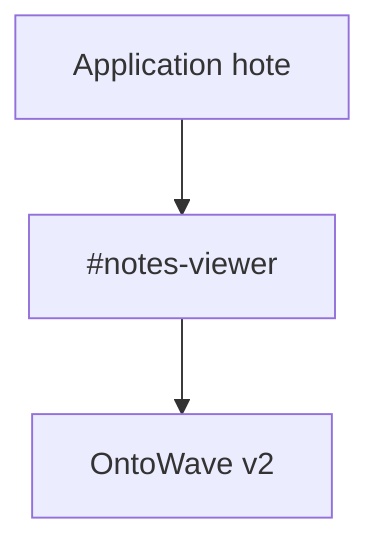

# Mode composant OntoWave

Ce document est rendu **dans un conteneur hote** (`#notes-viewer`) sans prise de controle du reste de la page.

## Verification rapide

- Le menu flottant doit rester dans le conteneur.
- Le header/footer du host restent inchanges.

